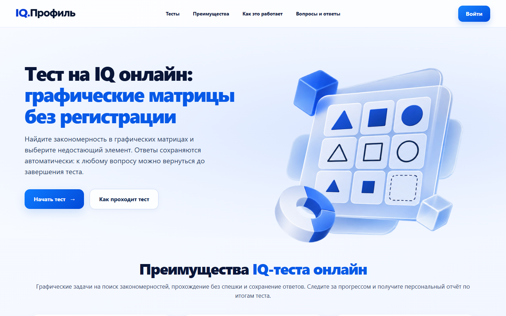

# IQ.Профиль

Веб-сервис с графическими заданиями на логику и поиск закономерностей. Позволяет пройти тест без регистрации, сохранить прогресс и получить персональный отчёт с результатами по направлениям заданий.

**Статус проекта:** функциональный демонстрационный MVP. Оплата и подписка имитируются: сервис не принимает банковские карты и не списывает деньги. Задания не являются стандартизированной методикой измерения IQ.

## Какую задачу решает

Графические задачи на закономерности часто публикуются без возможности продолжить прохождение, пересмотреть ответы или понять, в каких типах заданий возникли сложности. Сам по себе процент правильных ответов при этом нередко ошибочно подаётся как точный IQ-балл.

IQ.Профиль объединяет прохождение задач, сохранение попытки и отчёт в одном интерфейсе. Пользователь видит **количество верных решений, долю правильных ответов, время прохождения и результаты по категориям** — без необоснованных заявлений о психометрической точности.

## Возможности

| Задача | Что можно сделать |
| --- | --- |
| Пройти тест | Начать без регистрации, решать графические матрицы 3×3, находить недостающий элемент. |
| Управлять попыткой | Возвращаться к предыдущим вопросам, изменять ответы и продолжать незавершённую попытку. |
| Получить отчёт | Посмотреть общий результат, продолжительность и статистику по направлениям заданий. |
| Сохранить историю | Зарегистрировать аккаунт, вернуться к своим прохождениям и открытым отчётам. |
| Выгрузить данные | Скачать сводку завершённой оплаченной в деморежиме попытки в CSV из личного кабинета. |
| Посмотреть платёжный сценарий | Пройти экран предложения и подтверждение **демо-доступа** без платёжного провайдера. |
| Управлять подпиской | Отменить виртуальное продление без потери ранее открытого отчёта. |
| Администрировать | Просматривать пользователей, попытки, демо-транзакции и агрегированную статистику в кабинете администратора. |

Для теста используется собственный набор визуальных упражнений. Они развивают навык поиска закономерностей, но **не дают клинического заключения, научно нормированного IQ-показателя или процентиля**.

## Как работает сервис

1. Пользователь начинает тест без аккаунта и последовательно решает графические задания.
2. Выбранные ответы сохраняются на сервере. В той же браузерной сессии можно продолжить прохождение.
3. После завершения открывается страница с составом персонального отчёта.
4. Демо-подтверждение открывает отчёт. Указанные в интерфейсе **20 ₽ за первый доступ** и **499 ₽/месяц за последующее продление** демонстрируют тарифную модель, а не настоящие списания.
5. При регистрации результаты связываются с личным кабинетом; открытые отчёты доступны повторно.

## Инженерные решения

- **Серверная логика теста.** Вопросы, варианты ответов, навигация и результат хранятся отдельно от интерфейса. Правильные ответы не передаются как часть доступного пользователю выбора.
- **Контроль доступа.** Доступ к попыткам и отчётам проверяется на сервере по учётной записи или гостевой сессии. Для административных страниц есть отдельная проверка прав.
- **Повторяемые операции.** Демо-подтверждение не создаёт новую транзакцию при повторном запросе, а отменённое продление не активируется повторно.
- **Версионирование заданий.** Обновление банка задач учитывает версии попыток; завершённые результаты сохраняются.
- **Устойчивость интерфейса.** Blade-страницы доступны без обязательного клиентского фреймворка. Для основных сценариев предусмотрены серверные тесты и браузерные проверки.
- **Хранение данных.** SQLite используется с постоянным хранилищем при контейнерном развёртывании. Работа с существующей базой требует резервного копирования.

## Стек и структура

| Компонент | Технологии | Исходный код |
| --- | --- | --- |
| Сервер и бизнес-логика | PHP, Laravel | [app](app) |
| Страницы и стили | Blade, CSS, JavaScript, Vite | [resources](resources) |
| Данные и миграции | SQLite, Laravel migrations | [database](database) |
| Контейнеризация | Docker, Nginx, PHP-FPM | [Dockerfile](Dockerfile), [compose.yaml](compose.yaml) |
| Автоматические тесты | PHPUnit, Laravel Test, Playwright | [tests](tests), [scripts/browser-e2e.mjs](scripts/browser-e2e.mjs) |

Для входа через Яндекс предусмотрена OAuth-интеграция, которая активируется после настройки приложения и ключей.

## Проверка качества

В проекте есть серверные проверки жизненного цикла теста, регистрации, прав доступа, результатов и демонстрационной подписки. Браузерный сценарий Playwright проверяет прохождение, адаптивную вёрстку, Paywall → Checkout → Result и защиту чужих результатов. Для форматирования PHP используется Laravel Pint.

Инструкции по локальному запуску, проверкам, резервному копированию и Docker Compose вынесены в [руководство разработчика](docs/development.md). Перед коммерческим запуском используйте [юридический чек-лист](docs/legal-prelaunch-checklist.md).

## Ограничения демоверсии

- Реальных платежей, автоматических списаний и работы с платёжными картами нет.
- Отчёт описывает результаты данного набора упражнений и **не является официальной оценкой интеллекта**.
- Публичный production-адрес не указан до завершения развёртывания и проверки HTTPS.
- Для коммерческого запуска потребуются окончательные юридические документы, реквизиты оператора и отдельная интеграция с платёжным провайдером.

## Автор и использование кода

Проект [fedorovich-web](https://github.com/fedorovich-web).

Исходный код открыт для ознакомления с реализацией. Лицензия на свободное копирование, распространение и коммерческое использование не предоставлена; для повторного использования необходимо разрешение автора.
